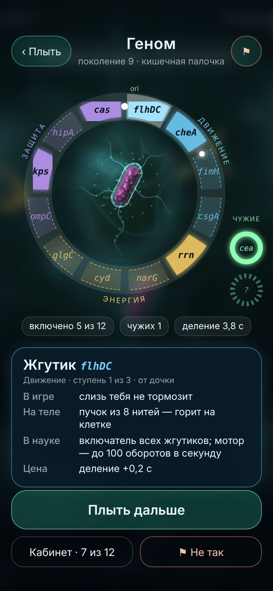
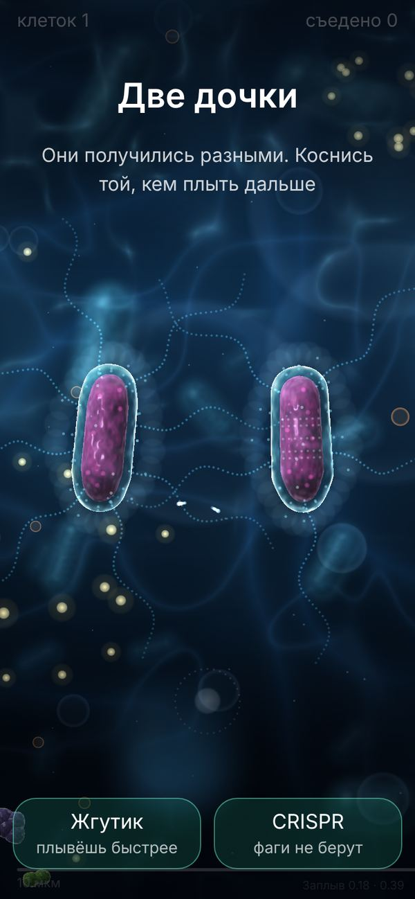
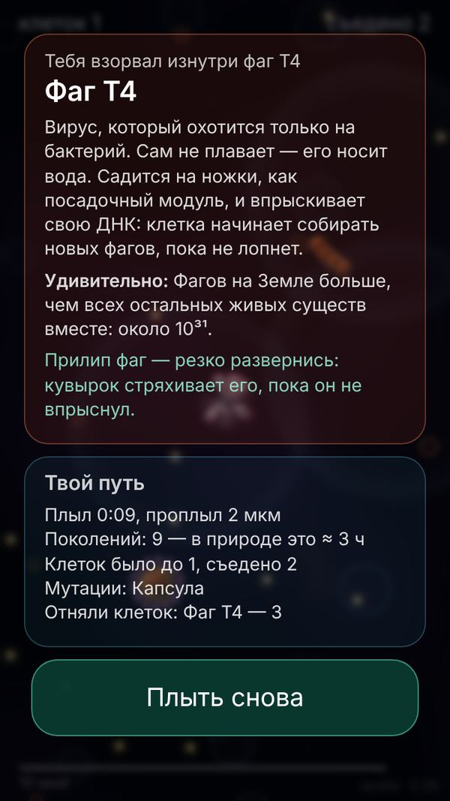

# Экраны и оформление

Главное правило (наше): **в заплыве почти нет текста**, игрок смотрит на клетку. Читать — на паузе, на экране гибели и в кабинете. Всё, что можно показать телом клетки, показываем телом.

| Экран | Пометки |
|---|---|
| **Э1** Заплыв: счётчики в углах, масштаб 10 мкм, номер версии | ✅ 0.3 · переделать по стилю ниже |
| **Э2** Всплывающее имя при первой встрече, без паузы | ✅ 0.12 |
| **Э3** Выбор из двух дочек | ✅ 0.19 · переделать по стилю ниже |
| **Э4** Экран гибели: кто убил, факт, как спастись, твой путь | ✅ 0.5 · переделать по стилю ниже |
| **Э5** Кабинет карточек | ✅ 0.12 |
| **Э6** Пауза с геномом | ✅ 0.25 (PR #101) · макет ниже |
| **Э7** Кнопка «не так»: одно касание ставит отметку с моментом игры | ✅ 0.26 (PR #102): флажок в игре, в геноме, на экране гибели; «Отправить · N» — меню «Поделиться» |
| **Э8** Единый стиль всех экранов | 💡 описан ниже |
| **Э9** Стартовый экран | 💡 |

## Пауза с геномом (макет)

- Кнопка паузы слева вверху, 44 пункта. Мир замирает и тускнеет за 0,2 с, кольцо разворачивается из клетки за 0,3 с.
- В центре твоя клетка, та же объёмная, крупно. Вокруг кольцо ДНК: у настоящей бактерии ДНК и правда кольцо внутри клетки.
- 12 своих генов в трёх дугах по 4: голубая **Движение**, жёлтая **Энергия**, сиреневая **Защита**. Каждый подписан настоящим именем курсивом (*flhDC*, *cas*). Спящий ген тусклый и в пунктире, проснувшийся светится.
- Справа столбик **Чужие**: колечки-плазмиды и вставки от фагов, зелёные. Пустое место — пунктир и «?»; касание подсказывает, где такие искать.
- Сверху метка *ori*: отсюда клетка копирует кольцо. По кольцу бежит белая точка, пока клетка готовится делиться.
- Касание гена: на клетке загорается его часть (жгутики, ореол, полоски), внизу карточка: в игре, на теле, в науке, цена, откуда пришёл.
- Строка под кольцом: включено из 12, чужих, время деления.
- Внизу: «Плыть дальше» (крупная, 56), «Кабинет», «⚑ Не так».

## Единый стиль (наше)

**Цвета.** Фон — тёмная вода игры, а не чёрный. Акцент и главные кнопки — бирюзовый свет (как сейчас). Гены по дугам: голубой движение, жёлтый энергия, сиреневый защита, зелёный плазмиды. Красно-оранжевый — только опасность, гибель и «не так». Новых цветов не вводим.

**Шрифт.** Системный шрифт iPhone. Пять размеров, не больше: 13 подписи, 15 текст карточек, 17 кнопки второго ряда и счётчики, 22 заголовки, 28 главный заголовок экрана. Имена генов — моноширинный курсив.

**Кнопки.** Главная одна на экран: высота 56, скруглённая, бирюзовая, внизу под большим пальцем. Второстепенные 44 в ряд под ней. Значки вместо слов только там, где смысл ясен: пауза, ⚑. Значки делает генератор картинок по образцу, кодом не рисуем.

**Отступы.** Шаг 8: поля по краям 16, между карточками 8–12, скругление карточек 20. Всё внутри безопасной зоны iPhone: сверху не заходим под «чёлку», снизу под полоску жестов.

**Карточки.** Одна форма для гена, существа и гибели: заголовок, строка-подзаголовок мелко, потом строки «подпись — значение». Рамка цвета своей группы.

**Переходы.** Ничего не появляется рывком. Слои плавно проявляются за 0,2–0,3 с, мир при этом замедляется, а не замирает щелчком. Тряску не используем, только лёгкое покачивание (Роман, 24.11: «с тряской не увлекайся! Может легкое покачивание?»).

## Экран за экраном

**Заплыв (Э1).** Слева вверху пауза, справа ⚑. По центру сверху маленькое кольцо генома: сколько мест занято, светится при новом гене, касание открывает паузу. Вместо «съедено N» показываем только разгон «рост ×1.6», когда он есть. Масштаб «10 мкм» и номер версии остаются мелко внизу. Всплывающие имена и счётчики всегда поверх мира, мир их не перекрывает.

**Две дочки (Э3).** Заголовок короче: «Кем плыть?». Под каждой дочкой одна строка: имя гена и что он даёт, цена мелко. Изменённая часть тела у дочки светится, чтобы разницу было видно сразу. Когда кольцо полное, под дочкой «вместо Хемотаксиса». Мир не замирает щелчком, а уходит в замедление.

**Гибель (Э4).** Сверху крупно тот, кто убил (его объёмная модель), имя и одна строка «как спастись». Факт и «твой путь» ниже, свёрнуты. Кнопка «Плыть снова» всегда видна внизу, рядом «Кабинет» и «Геном».

**Кабинет (Э5).** Закрывает весь экран. Сетка карточек по две в ряд, у встреченных — кадр существа, у невстреченных силуэт. Касание открывает карточку целиком.

**Старт (Э9).** Капля под микроскопом, твоя палочка плавает в центре. Одна кнопка «Плыть», под ней мелко «Кабинет» и «Геном». Никаких обучающих окон: первое касание и есть обучение.

## Что сейчас неладно (кадры 0.20, iPhone 13)

| | Что видно | Как исправить |
|---|---|---|
| **Э10** | Объекты мира рисуются поверх всплывающей надписи и счётчика | надписи всегда поверх мира |
| **Э11** | Кабинет не закрывает верх экрана, под ним видна игра | кабинет на весь экран |
| **Э12** | Подпись дочки «CRISPR: фаги не берут» неверна по науке | по сверке: «помнишь фагов, которых пережил» |
| **Э13** | Кнопки дочек налезают на полоску масштаба | масштаб прятать на время выбора |
| **Э14** | Экран гибели — стена текста, «Кабинет» уходит за край | раскладка выше |

