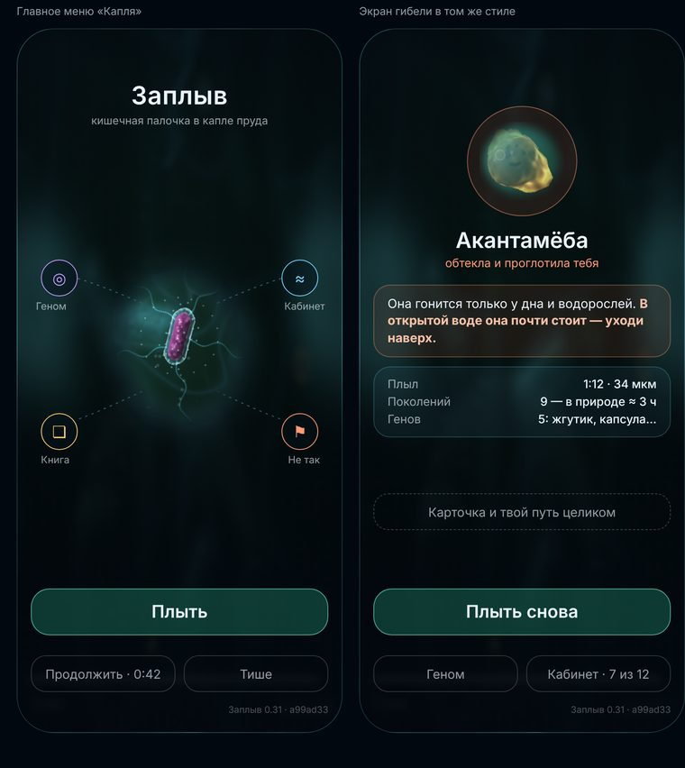
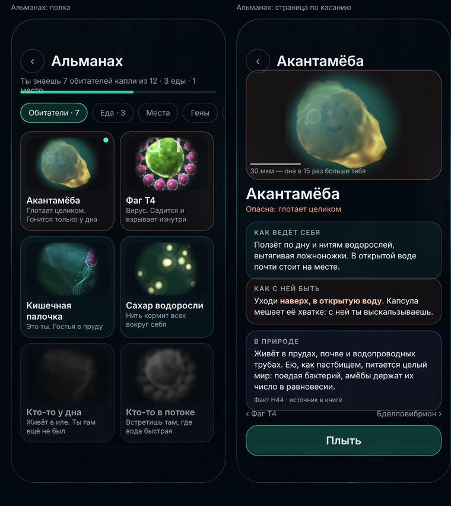
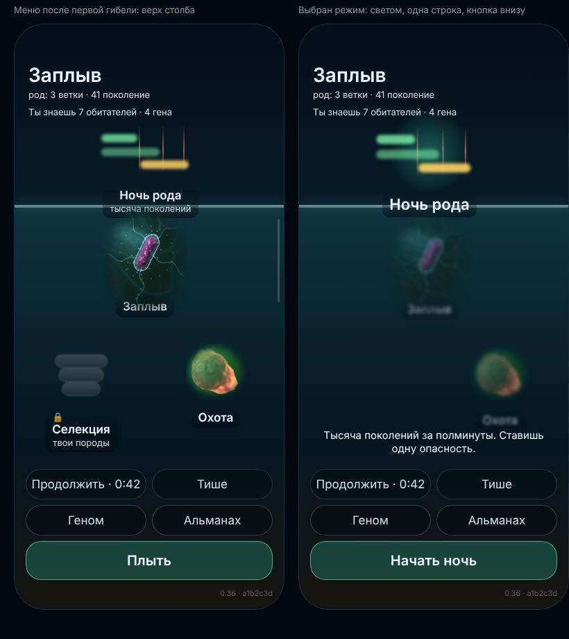

# Экраны и оформление

Главное правило (наше): **в заплыве почти нет текста**, игрок смотрит на клетку. Читать — на паузе, на экране гибели и в кабинете. Всё, что можно показать телом клетки, показываем телом.

| Экран | Пометки |
|---|---|
| **Э1** Заплыв: счётчики в углах, масштаб 10 мкм, номер версии | ✅ 0.3 · переделать по стилю ниже |
| **Э2** Всплывающее имя при первой встрече, без паузы | ✅ 0.12 |
| **Э3** Выбор из двух дочек | ✅ 0.19 · переделать по стилю ниже |
| **Э4** Экран гибели: кто убил, факт, как спастись, твой путь | ✅ 0.5 · переделать по стилю ниже |
| **Э5** Альманах (бывший кабинет) | ✅ 0.12 · ⚠️ Роман 24.11: «что он такой ебаный кабинет 12 из 13 что это значит, где изображения, где образовательный контент, где структура» · 🔧 переделка, спецификация ниже |
| **Э6** Пауза с геномом | ✅ 0.25 (PR #101) · макет ниже |
| **Э7** Кнопка «не так»: одно касание ставит отметку с моментом игры | ✅ 0.26 (PR #102): флажок в игре, в геноме, на экране гибели; «Отправить · N» — меню «Поделиться» |
| **Э8** Единый стиль всех экранов | 💡 описан ниже |
| **Э9** Главное меню «Капля» | 💡 спецификация ниже |
| **Э15** Экран гибели в новом стиле | 🔧 первая часть в игре с 0.40: называет убийцу, показывает его модель и тексты книги; остальное по спецификации ниже |
| **Э16** Значки генов — снимки клетки | ✅ 0.36 |

## Пауза с геномом (макет)

- Кнопка паузы слева вверху, 44 пункта. Мир замирает и тускнеет за 0,2 с, кольцо разворачивается из клетки за 0,3 с.
- В центре твоя клетка, та же объёмная, крупно. Вокруг кольцо ДНК: у настоящей бактерии ДНК и правда кольцо внутри клетки.
- 12 своих генов в трёх дугах по 4: голубая **Движение**, жёлтая **Энергия**, сиреневая **Защита**. Каждый подписан настоящим именем курсивом (*flhDC*, *cas*). Спящий ген тусклый и в пунктире, проснувшийся светится.
- Справа столбик **Чужие**: колечки-плазмиды и вставки от фагов, зелёные. Пустое место — пунктир и «?»; касание подсказывает, где такие искать.
- Сверху метка *ori*: отсюда клетка копирует кольцо. По кольцу бежит белая точка, пока клетка готовится делиться.
- Касание гена: на клетке загорается его часть (жгутики, ореол, полоски), внизу карточка: в игре, на теле, в науке, цена, откуда пришёл.
- Строка под кольцом: включено из 12, чужих, время деления.
- Внизу: «Плыть дальше» (крупная, 56), «Кабинет», «⚑ Не так».

## Единый стиль (наше)

**Цвета.** Фон — тёмная вода игры, а не чёрный. Акцент и главные кнопки — бирюзовый свет (как сейчас). Гены по дугам: голубой движение, жёлтый энергия, сиреневый защита, зелёный плазмиды. Красно-оранжевый — только опасность, гибель и «не так». Новых цветов не вводим.

**Шрифт.** Системный шрифт iPhone. Пять размеров, не больше: 13 подписи, 15 текст карточек, 17 кнопки второго ряда и счётчики, 22 заголовки, 28 главный заголовок экрана. Имена генов — моноширинный курсив.

**Кнопки.** Главная одна на экран: высота 56, скруглённая, бирюзовая, внизу под большим пальцем. Второстепенные 44 в ряд под ней. Значки вместо слов только там, где смысл ясен: пауза, ⚑. Значки делает генератор картинок по образцу, кодом не рисуем.

**Отступы.** Шаг 8: поля по краям 16, между карточками 8–12, скругление карточек 20. Всё внутри безопасной зоны iPhone: сверху не заходим под «чёлку», снизу под полоску жестов.

**Карточки.** Одна форма для гена, существа и гибели: заголовок, строка-подзаголовок мелко, потом строки «подпись — значение». Рамка цвета своей группы.

**Переходы.** Ничего не появляется рывком. Слои плавно проявляются за 0,2–0,3 с, мир при этом замедляется, а не замирает щелчком. Тряску не используем, только лёгкое покачивание (Роман, 24.11: «с тряской не увлекайся! Может легкое покачивание?»).

## Экран за экраном

**Заплыв (Э1).** Слева вверху пауза, справа ⚑. По центру сверху маленькое кольцо генома: сколько мест занято, светится при новом гене, касание открывает паузу. Вместо «съедено N» показываем только разгон «рост ×1.6», когда он есть. Масштаб «10 мкм» и номер версии остаются мелко внизу. Всплывающие имена и счётчики всегда поверх мира, мир их не перекрывает.

**Две дочки (Э3).** Заголовок короче: «Кем плыть?». Под каждой дочкой одна строка: имя гена и что он даёт, цена мелко. Изменённая часть тела у дочки светится, чтобы разницу было видно сразу. Когда кольцо полное, под дочкой «вместо Хемотаксиса». Мир не замирает щелчком, а уходит в замедление.

**Гибель (Э4).** Сверху крупно тот, кто убил (его объёмная модель), имя и одна строка «как спастись». Факт и «твой путь» ниже, свёрнуты. Кнопка «Плыть снова» всегда видна внизу, рядом «Кабинет» и «Геном».

**Кабинет (Э5).** Закрывает весь экран. Сетка карточек по две в ряд, у встреченных — кадр существа, у невстреченных силуэт. Касание открывает карточку целиком.

**Старт (Э9).** Капля под микроскопом, твоя палочка плавает в центре. Одна кнопка «Плыть», под ней мелко «Кабинет» и «Геном». Никаких обучающих окон: первое касание и есть обучение.

## Главное меню «Капля» (Э9) — спецификация для стройки

Роман, 24.11: «пускай дизайнер опишет концепт меню в соответствии со стилистикой».

**Замысел (наше).** Меню — это не список кнопок поверх игры, а та же капля под микроскопом, только спокойная. В середине медленно плывёт твоя клетка со всеми генами, которые ты собрал. Разделы висят вокруг неё, как рецепторы, и соединены с клеткой тонкими пунктирными нитями: всё в меню принадлежит клетке, а не приложению.

**Состав экрана сверху вниз**

| Что | Где | Размер и вид |
|---|---|---|
| Заголовок «Заплыв» | по центру, отступ сверху 62 от безопасной зоны | 30, полужирный |
| Подпись «кишечная палочка в капле пруда» | под ним | 13, прозрачность 0,62 |
| Твоя клетка | центр, 150×186 | та же модель, что в игре, с твоими генами; покачивается и медленно плывёт по восьмёрке с размахом 12 |
| Четыре узла | по углам вокруг клетки, 44×44, круг | «Геном» сиреневый, «Кабинет» голубой, «Книга» жёлтый, «Не так» оранжевый; подпись 12 под узлом |
| Нити | от клетки к узлам | пунктир 3 на 5, толщина 1,2, цвет узла с прозрачностью 0,35 |
| «Плыть» | внизу, поля 16 | высота 56, скругление 22, бирюзовая |
| «Продолжить · 0:42» и «Тише» | под ней | высота 44, в ряд, прозрачные |
| Версия и sha | правый нижний угол | 11, прозрачность 0,3 |

**Что видно и когда**

- «Продолжить» появляется, только если есть незаконченный заплыв; иначе «Плыть» занимает ряд один.
- Узел «Геном» светится, если с прошлого раза появился новый ген. «Кабинет» показывает «7 из 12», когда есть новые карточки.
- Пока генов нет, узлы «Геном» и «Кабинет» приглушены до 0,45, но нажимаются: внутри написано, что там появится.
- Первый запуск: узлы и нити проявляются по очереди за 0,6 с, клетка вплывает снизу.

**Движение.** Фон — та же вода, что в игре, но втрое спокойнее: взвесь дрейфует, лучи едва заметны. Клетка покачивается, жгутики бьют вполсилы. Касание узла: узел вспыхивает, клетка поворачивается к нему носом, и раздел выезжает снизу за 0,25 с. Возврат — клетка выравнивается. Касание «Плыть»: камера наезжает на клетку, фон оживает до полной силы, и заплыв начинается без перезагрузки экрана.

**Звук.** Один мягкий низкий гул воды, тише, чем в игре. У касания узла короткий влажный щелчок.

**Чего не делаем.** Никаких прямоугольных плашек списком, рамок «окон», теней под текстом, иконок из набора. Ничего не мигает чаще раза в две секунды.

## Экран гибели (Э15) — спецификация

Сейчас это стена текста, и «Кабинет» уходит за край. Новый порядок:

| Что | Размер |
|---|---|
| Кто убил: его модель в круге 132, рамка цвета опасности | сверху, отступ 92 |
| Имя и строка «обтекла и проглотила тебя» | 26 и 14 |
| Подсказка, как спастись | карточка на всю ширину, 15, главное выделено цветом опасности |
| «Твой путь»: три строки — сколько плыл, поколений, генов | 14, подпись слева, значение справа |
| «Карточка и твой путь целиком» | пунктирная кнопка 44, раскрывает остальное |
| «Плыть снова» | 56, внизу |
| «Геном» и «Кабинет · 7 из 12» | 44, в ряд |

Правило: на первом экране помещается всё, что нужно, чтобы понять, отчего ты погиб, и сразу плыть снова. Подробности — под кнопкой.

## Альманах (Э5) — спецификация переделки

Роман, 24.11: «Кабинет доделайте… 12 из 13 что это блять значит, где блять сами изображение о ком речь? Где образовательный контент? Где структура!»

Роман, 24.11: «Альманах внутренний тоже какой-то структурированный пускай гейм-дизайнеры пишут. Он так должен называться!» Кабинет переименован в **Альманах** — во всех экранах, кнопках и всплывающих надписях сразу, старого слова не остаётся нигде.

**Разделы Альманаха (наше).** Шесть, в этом порядке: **Обитатели** (кто живёт в капле), **Еда** (что и как ешь), **Места** (толща, дно, водоросли, ил, поток), **Гены и навыки** (твои умения значками-снимками), **Отношения** (кто кого ест, кто кого кормит, кто с кем дерётся), **Твой штамм** (родословная и ветка, когда выйдет В2 и Р1). Первые два открыты с начала, остальные появляются, когда в них попадает хотя бы одна запись.

**Единая форма страницы.** Любая запись Альманаха, будь то существо, еда, место или ген, выглядит одинаково: модель сверху, масштаб рядом с собой, имя, ярлык группы, блоки **КАК ВЕДЁТ СЕБЯ** / **КАК С НЕЙ БЫТЬ** / **В ПРИРОДЕ**. Так игрок не учится заново на каждой вкладке.

**Откуда берутся тексты.** Из записей книги: имя, «в игре» и факт пишет копирайтер в `zapisi/`, игра их читает, а сверка следит, чтобы текст в игре и в книге не разошёлся. Альманах — это книга глазами игрока, без номеров и служебных слов.

**Полка**

| Что | Как |
|---|---|
| Экран | весь, фон как в меню: вода под плотной вуалью |
| Шапка | «‹» 44 и «Альманах» 26 |
| Счётчик | словами: «Ты знаешь 7 обитателей капли из 12 · 3 еды · 1 место», под ним полоска. Дробей без объяснения не пишем |
| Разделы | ряд пилюль 36, листается вбок: «Обитатели · 7», «Еда · 3», «Места», «Гены», «Отношения», «Твой штамм». Внутри обитателей рамка карточки красит группу: опасные оранжевая, соседи голубая |
| Сетка | по две карточки в ряд, ширина 171, скругление 20, промежуток 10 |
| Карточка | картинка 96 — снимок живой модели из игры в одном положении и масштабе; имя 16; одна строка 12,5 «кто это». Рамка цвета группы: опасные оранжевая, соседи голубая, еда жёлтая. Новая — точка в углу |
| Невстреченные | не «???», а силуэт той же модели в тумане и подсказка, где искать: «Живёт в иле. Ты там ещё не был» |

**Карточка по касанию**

| Что | Как |
|---|---|
| Модель | крупно, рамка 200 высотой, цвет группы |
| Масштаб | полоска и строка «30 мкм — она в 15 раз больше тебя» |
| Имя | 28, под ним ярлык цветом группы: «Опасна: глотает целиком» |
| **КАК ВЕДЁТ СЕБЯ** | голубой блок, 2–3 предложения |
| **КАК С НЕЙ БЫТЬ** | оранжевый блок, главное выделено цветом |
| **В ПРИРОДЕ** | сиреневый блок: настоящий факт и строка «Факт Н44 · источник в книге» |
| Листание | «‹ Фаг T4» и «Бделловибрион ›» внизу |
| Кнопка | «Плыть» 56 |

Тексты «В природе» берём из записей книги (их пишет копирайтер по базе биолога) и всегда ставим номер факта. Нет факта — просим биолога, не выдумываем.

**Раздел «Отношения» (наше).** Не список, а короткие связки: «Запятая ест палочек, а кокков не трогает», «Водоросль кормит всех вокруг себя», «Амёба глотает целиком, капсула мешает». Каждая связка — строка с двумя значками и стрелкой между ними, касание ведёт на страницу любого из двоих. Это то, чего Роман не нашёл в кабинете: видно не «кто есть кто», а «кто с кем».

## Что сейчас неладно (кадры 0.20, iPhone 13)

| | Что видно | Как исправить |
|---|---|---|
| **Э10** | Объекты мира рисуются поверх всплывающей надписи и счётчика | надписи всегда поверх мира |
| **Э11** | Кабинет не закрывает верх экрана, под ним видна игра | кабинет на весь экран |
| **Э12** | Подпись дочки «CRISPR: фаги не берут» неверна по науке | по сверке: «помнишь фагов, которых пережил» |
| **Э13** | Кнопки дочек налезают на полоску масштаба | масштаб прятать на время выбора |
| **Э14** | Экран гибели — стена текста, «Кабинет» уходит за край | раскладка выше |

## Новая карта и новый Альманах (Э22–Э34)

Спецификация дизайнера, 25.11. Она заменяет карту слоями (Э17–Э20): Роман ту карту забраковал, а холодный игрок задание по ней не выполнил совсем. Экран теперь принимает холодный игрок на живой сборке по заданиям; без его протокола экран не выходит (задания: design/zaplyv_zadaniya_priemki.md).

### Карта

**Э22. Зачем карта.** Карта отвечает на три вопроса и больше ни на что: где я, куда плыть за едой, куда не соваться. Экран, который не оставляет ничего в заплыве, мы не делаем.

**Э23. Что на ней нарисовано.** Не четыре подписанные полосы, а места с человеческими именами: Плёнка, Светлая толща, Граница кислорода, Ил, Тёплое мелководье. Место рисуется картинкой (блеск плёнки, пыльца, корень, бурое дно), а не заливкой. У каждого имени вторая строка в одно короткое предложение: чем это место живёт. Имя места появляется, когда ты там побывал; до этого стоит серая надпись «не был».

**Э24. Где я и где был.** Твоя клетка — яркая точка с конусом направления и подписью «ты». За ней пунктирный след последних сорока секунд. Где не был — туман, но туман приглушает, а не закрашивает: очертания мест видно всегда, иначе карта пустая и открывать её незачем.

**Э25. Еда на карте обязательна.** Каждое съеденное пятно оставляет золотую метку с временем: «еда, 40 секунд назад». Живое пятно (нить, комок, корень) остаётся меткой навсегда, пока живо; разлив гаснет через минуту. Без этого задание «куда плыть за едой» по карте невыполнимо — именно на нём холодный игрок и встал.

**Э26. Как перемещаться.** Карта тянется пальцем и сводится щипком. Касание места или метки ставит цель: снизу выезжает карточка с именем, строкой «сколько секунд плыть» и кнопкой «Плыть сюда» 56. Расстояние пишется в секундах, не в микронах. Телепорта нет. В заплыве к цели ведёт стрелка у края экрана с именем цели и обратным отсчётом секунд; доплыл — плашка «Ты на месте» и метка гаснет.

**Э27. Нажимаемость видно.** Метка и место, которые можно тронуть, имеют светлую обводку и отзываются подсветкой под пальцем. Холодный игрок нашёл эту возможность случайно на девятом касании — значит, её не было.

**Э28. Верх и низ видно в самом заплыве.** Без этого карта слоёв не читается: игрок плывёт как сверху, а карту видит сбоку. В заплыве: свет сверху и темнота ко дну, медленно тонущие крошки, граница слоя как мерцающая полоса с подписью в одну строку, линейка глубины у правого края с отметками «плёнка» и «ил» и твоим положением. Путь до ила сжимаем до 25–30 секунд, чтобы первое погружение случилось в первом заплыве.

### Альманах

**Э29. Главная — не список и не счётчики.** Сверху «Последняя находка»: кто тебя только что съел или кого ты встретил, и строка «как уйти живым». Ниже крупные разделы картинками, по два в ряд: Обитатели, Еда, Твои гены, Кто кого ест, Места капли. На плитке — живая модель, имя раздела и одна серая строка вроде «встречено 2 из 10». Общего счётчика из трёх чисел и одной полоски нет: холодный игрок не смог сказать, что она показывает.

**Э30. Раздел.** Хлебные крошки «Альманах · Обитатели». Фильтры-таблетки: Все, Опасные, Соседи, Новые. Карточки в два столбца с моделями. Встреченные — первыми, невстреченные — силуэтом в конце и не больше четырёх подряд, чтобы экран не состоял из пустых плиток. У силуэта подсказка о месте, а не общая фраза: «ищи у дна, в иле».

**Э31. Опасность видно по плитке.** У хищника тёплая обводка и строка «глотает целиком». Сейчас хищник и мирный сосед выглядят одинаково, и чтобы найти, кто тебя ест, надо открыть всех по очереди.

**Э32. Карточка.** Крупная модель, которую можно повернуть пальцем. Имя, ярлык «Опасна», строка «кто это · размер · сколько раз встречал». Блоки: КТО ЭТО, КАК УЙТИ ЖИВЫМ (у хищника) или ЧТО ДАЁТ (у гена), В ПРИРОДЕ — два-четыре предложения, из книги, за подписью биолога. Внизу связи как ссылки: «глотает: тебя», «боится: капсулы» — каждая открывает свою карточку. Кнопка «Показать на карте» 56, если место известно.

**Э33. Одно имя везде.** Имя гена и существа берётся из одного файла и совпадает на карточке выбора, во всплывашке и в Альманахе. Расхождение валит сборку. Холодный игрок встретил один ген под тремя именами и трижды решил, что промахнулся мимо кнопки.

**Э34. Путь со смерти.** С экрана гибели одно касание открывает карточку убийцы. Сейчас это единственное место в игре, где игроку прямо говорят, что делать, и оно спрятано.

### Приёмка

Экраны принимаются по заданиям из zaplyv_zadaniya_priemki.md, холодным игроком на живой сборке, с протоколом в репозитории. Моё слово — после протокола, не вместо него.

## Старая карта слоями (Э17–Э20), заменена

✅ Первый слой в игре с 0.41: три вкладки на паузе, разрез пруда с туманом, отметки гибели и генов, карточка места, метка-цель. Не вошли: ориентиры, отметки еды и встреч, список при трёх и больше отметках, первый запуск.

Роман, 24.11: «карта — да, нужно понять, как её грамотно встроить, наверное в паузе вкладка карта — с дизайнерами»; «на критику профессионалу карту отдайте и внедрите». Критику прошли 24.11 у стороннего UX и гейм-дизайнера мобильных игр, его правки внесены ниже и помечены 🔎. Запись мира — **К1**, ориентиры — **К3**, тёплый берег — **К4**.

**Э17 Пауза — один экран с тремя вкладками.** Пауза перестаёт быть окошком поверх игры и становится экраном на весь телефон: тот же тёмный фон воды, мир под ним замедляется и размывается, а не щёлкает. Сверху слово «Пауза». 🔎 Кнопки «‹» нет совсем: из паузы один выход — «Плыть» внизу и смахивание вниз, чтобы в опасную минуту нельзя было промахнуться в главное меню. Три вкладки одной формы, высота 44, в один ряд, без прокрутки: **Геном · Карта · Альманах**. Открывается та, с которой ты ушёл в прошлый раз. 🔎 В самый первый заплыв открывается **Геном**, а не Карта: карта в первый раз пуста, и пустым экраном знакомиться нельзя. Карта становится вкладкой по умолчанию после первой гибели, когда на ней появилась первая отметка. Внизу всегда одна главная кнопка «Плыть» высотой 56. Переход между вкладками — сдвиг за 0,2 с, свайп влево-вправо работает тоже, прокрутка внутри вкладки сохраняется.

**Э18 Карта — пруд в разрезе, стоя.** Вертикальный телефон и есть разрез пруда, поэтому карта не поворачивается, не двигается пальцем и не масштабируется: она занимает экран целиком сверху донизу.

- Сверху вниз четыре слоя своим цветом, полосами разной высоты: **плёнка** (светлая нитка у самого верха, бахрома корней ряски вниз), **светлая толща** (самая высокая полоса, в ней нити водорослей), **граница кислорода** (тонкая дымка, где кислорода ровно столько, сколько нужно), **ил** слоями. 🔎 Новых цветов карта не вводит: ил — затемнённый жёлтый «энергии» из общей палитры.
- Слева направо: **заросли у берега**, открытая вода, **тёплый берег** светлым пятном на краю (К4) — цель видна с первой минуты.
- **Ориентиры (К3) нарисованы, а не подписаны:** стебель от ила до плёнки, бахрома корней, большая песчинка. Имя всплывает только по касанию. 🔎 Нити водорослей приглушить до альфы 0,2 и оставить две: они спорят по яркости с отметками и стеблем.
- **Где ты сейчас:** твоя клетка своей моделью. 🔎 Кольцо-пульс 24 пункта, яркость на треть ниже прежней: «ты здесь» — не новость, и оно не должно быть самым ярким пятном экрана. 🔎 Самой яркой на карте при открытии делается последняя отметка этого заплыва, она подсвечивается 1,2 с.
- 🔎 **Туман различим на солнце.** Непройденное отличается не яркостью, а тремя свойствами сразу: насыщенность ×0,35, яркость −18 %, поверх зерно 6–8 % и размытие 4. Край, где туман разошёлся, — светлая линия 1 с альфой 0,25. Проверять замером: «открыто» к «закрыто» не меньше 1,6:1 по яркости. Расходится туман мягким пятном за 0,3 с, круги не рисуем.
- 🔎 **Подписи слоёв** — #CFE3E6, 13 полужирный, разрядка 0,06em, альфа не ниже 0,78, под текстом тёмная плашка-градиент альфы 0,35 высотой 20, а не тень. **«Тёплый берег»** — #FFD79A на подложке, размер 15, контраст не ниже 4,5:1. Контраст мерить на самом светлом пикселе, который может попасть под подпись.
- 🔎 **Шапка вместо подвала:** строки «100 мкм», «ты на 2 мм от дна» и «Ты видел три места из семи» стоят под вкладками, где их не закрывает карточка. По правому краю — линейка глубины шириной 2 с насечками, меткой игрока и тонкими рисками на высоте отметок.
- 🔎 **Safari:** высота считается в `dvh`, не `vh`, снизу 34 под полоску жестов, иначе «Плыть» уедет под адресную строку.

**Э19 Отметки: карта помнит твои заплывы.** Это то, из-за чего карту открывают, поэтому отметка — самый заметный объект карты, а не фон.

- 🔎 **Вид отметки:** цель касания 44, видимая часть 32, рамка 3. Внутри не цветной кадр, а обесцвеченный силуэт существа, светлее воды (серый 0,9) на подложке цвета смысла с альфой 0,25, под отметкой тёмное гало, иначе на светлом иле она пропадёт. Цифра слипшихся — кружок 18, шрифт 13 с тёмной обводкой.
- 🔎 **Смысл несёт не только цвет, но и форма** (красную от зелёной не отличает каждый двенадцатый мужчина): **где погиб** — острые углы, красно-оранжевый, значок убийцы; **где нашёл чужой ген** — круглая, зелёная, значок гена; **где была еда** — точка без рамки, гаснет к следующему заплыву (К2); **кого встретил** — пунктир, бледная.
- 🔎 **Легенда** одной строкой под картой, высота 24, шрифт 13: четыре значка по 16 со словом — гибель · ген · еда · встреча.
- Касание отметки открывает карточку. 🔎 Если отметок на месте больше трёх, они слипаются в одну с цифрой, и касание открывает не карточку, а список из трёх строк по 44.
- 🔎 Отклик на касание — значок увеличивается до 1,06 за 90 мс: в Safari дрожь телефона нам недоступна, а без отклика на солнце не понять, попал ты или нет.

**Э20 Карточка места и метка-цель.** 🔎 Карточка больше не закрывает собой карту: высота не больше 45 % экрана, внутри прокрутка, сверху ручка 36×4, закрывается смахиванием вниз и касанием мимо, до кнопки «Плыть» зазор 24. При открытии карта доезжает так, чтобы задетое место осталось видно сверху, и обводит его кольцом. Внутри: имя, строка «от ила до плёнки» (слово «ориентир» убрано — игрок и так по нему попал), одна строка «что там», значки жителей, строка-направление «вниз по стеблю, примерно полминуты».

🔎 **Метка-цель — то, ради чего карту открывают второй раз.** Второй строкой в карточке кнопка 44 «Запомнить это место». Метка одна за раз. В заплыве она даёт у края экрана тонкую стрелку в свою сторону, 24 пункта, альфа 0,4, и расстояние «≈0,4 мм». Доплыл — стрелка гаснет сама мягким импульсом. Переноса по карте по-прежнему нет: дорога остаётся работой заплыва, но держать её в голове больше не нужно.

**Чего на карте нет (наше).** Сетки, компаса, процентов открытия, миникарты в заплыве, кнопки «плыть сюда», зума и перетаскивания. Счёт открытого — словами. 🔎 Когда отметок станет больше двенадцати, добавим три чипа-фильтра по 44 («гибель · гены · встречи»), раньше не надо.

**Приёмка.** Та же, что у Альманаха, плюс замеры: контраст подписей не ниже 4,5:1, «открыто» к «закрыто» не ниже 1,6:1, цели касания 44 с зазором 8, карточка не перекрывает метку игрока, «Плыть» не уезжает под адресную строку Safari. Кадры всех вкладок, карты с туманом и отметками и карточки с меткой-целью — до слияния.

## Меню-сценка с режимами (Э21) — спецификация для стройки

Роман, 24.11: «можно попробовать реализовать как режимы игры внутри того что у нас есть — механики существующие!.. вот и меню профессиональное пригодится… Меню придумать внутри интерактивное… там эволюция происходит, чтобы выбор был визуального соответствующего объекта из общей сцены! Чтобы в менюшке не просто текст, а сценка!»

Набор режимов ведёт тред симулятора эволюции (design/zaplyv_rezhimy.md), сцену — мы. Критику прошли 24.11 у стороннего UX и гейм-дизайнера мобильных игр, его правки помечены 🔎. Эта спецификация заменяет прежнее меню **Э9**: там, где они расходятся, верна эта.

**Объекты сцены и режимы.** Восемь режимов, все на нынешних механиках:

| Объект в капле | Режим | Когда |
|---|---|---|
| Твоя клетка у плёнки, плывёт | **Заплыв** — как сейчас | открыт всегда |
| Тёмный верх над плёнкой, куда уходят поколения | **Ночь рода** — тысяча поколений за полминуты, ставишь одну опасность, выбираешь выжившую ветку | первым в стройку |
| Стопка замороженных капель (**В1**) | **Селекция** — твои породы | после первой своей ветки |
| Плот сцепленных клеток | **Стая** — играешь плотом (ген «Сцепка» **Г24**) | после «Сцепки» |
| Красная запятая кружит около твоей клетки | **Хищник** — бделловибрион (**Р3**) | после трёх гибелей от неё |
| Высохший край капли с трещинами | **Засуха** — выжить, когда воды мало | позже |
| Слоистый камень в иле | **Глубокое время** — древняя капля (**В7–В13**) | позже |
| Тёмный просвет с огоньками за краем | **Море** — вибрион (**Р7**) | последним |

🔎 **Сцена — водяной столб, а не поле с плитками.** Капля показана в глубину, экран прокручивается вверх-вниз одним большим пальцем, и сама прокрутка читается как глубина. Слои сверху вниз: **сейчас** (заплыв, хищник), **твой род** (ночь рода — тёмный верх над плёнкой, селекция, стая), **прошлое** (древняя капля, засуха), **дальше** (море за краем). Правила, которые держат сцену сценой:

- 🔎 Одновременно на экране не больше **четырёх** объектов, между центрами не меньше **120**.
- 🔎 Место объекта в сцене назначается один раз и не меняется между версиями: переехавший «Заплыв» ломает память пальца, и это главный риск сцены против списка.
- 🔎 Новый режим приходит в свой слой, а не на свободное место.
- 🔎 Объекты отвечают друг другу: запятая подплывает к твоей клетке, клетка отворачивается и отходит. Полсекунды движения говорят «охота — это когда едят тебя» лучше любой подписи. Твоя клетка — якорь сцены: при выборе объекта она поворачивается к нему носом.
- 🔎 Наклон телефона даёт слоям параллакс ±6.

🔎 **Главное действие всегда под пальцем.** Внизу закреплена одна кнопка 56, скругление 22, поля 16, снизу безопасная зона плюс 8. Подпись меняется по выбранному объекту: «Плыть», «Начать ночь», «Выйти на охоту». Режим по умолчанию выбран заранее, поэтому обычный заплыв — **одно** касание. Касание объекта только выбирает (меняет подпись кнопки), двойное касание объекта запускает сразу. Над кнопкой ряд 44: «Продолжить · 0:42», если заплыв не закончен, и «Тише». Ниже ряда — «Геном» и «Альманах» (слово «Книга» убрано: это служебное слово проекта, а не раздел игры). В правом нижнем углу версия и sha, 11, прозрачность 0,3.

🔎 **Выбор показывается светом, а не рамкой** (прямоугольные плашки запрещены): объект растёт до 1,08, вокруг ореол своего цвета 24 прозрачностью 0,5, остальная сцена уходит в 0,55 и блюр 4 за 0,2 с, картинка объекта остаётся на месте. Текста при выборе — **одна строка, не длиннее одиннадцати слов**: «Тысяча поколений за полминуты. Ставишь одну опасность». Длинное объяснение живёт на первом экране самого режима. Отдельной карточки с кнопкой нет.

🔎 **Первый запуск — без меню.** Игра открывается сразу каплей, первое касание и есть обучение. Меню впервые показывается после первой гибели, когда есть из чего выбирать и появилась «Ночь рода». Строка под заголовком — состояние, а не украшение: до первой гибели «капля пруда, 10 мкм», после — «род: 3 ветки · 41 поколение». Подсказки словами «коснись того, во что хочешь сыграть» нет: объект по умолчанию раз в 3 с пускает по краю бирюзовую волну 0,4 с, а при первом показе меню от клетки к нему один раз идёт рябь.

🔎 **Прогресс одной строкой, словами:** «Ты знаешь 7 обитателей · 4 гена · 41 поколение». Дробей «12 из 13» не пишем, Роман их уже отверг. Новое — одна бирюзовая точка 6 у объекта, без чисел.

🔎 **Закрытые режимы — силуэт в тумане, а не прозрачность** (тот же приём, что у невстреченных в Альманахе): объект залит цветом фона светлее на 8 %, контур 1,5 прозрачностью 0,5, у подписи один значок замка 16. Закрытое **нажимается** и отвечает одной строкой словами игрока, а не терминами: «Доплыви до ила — и увидишь, что было в капле миллиард лет назад». Если до открытия есть измеримый путь, по краю объекта идёт тонкая дуга заполнения. Самый дальний режим (море) на первых заплывах не показывается вовсе: пять объектов, из которых два мертвы, хуже трёх живых.

🔎 **Читаемость.** Любая подпись не ниже 4,5:1, закрытая не ниже 3:1 (гасим вуалью под текстом, а не прозрачностью самого текста). Имя режима 17 полужирный, пояснение 13, больше двух строк не писать. Пояснение только там, где имя непонятно: под «Охотой» строка «играть за хищника» лишняя. Цель касания объекта вместе с подписью не меньше 72×72, зазор между целями 12, нижние кнопки 44. Под подписью тёмный градиент высотой 40 прозрачностью 0,55, иначе светящийся объект съест текст на солнце. Подпись ставится над объектом в нижней половине экрана и под объектом в верхней, чтобы палец не закрывал то, что трогает.

**Значки опасностей для «Ночи рода» (наше).** Опасностей ровно три, у каждой свои гены защиты: **фаги** (замок и CRISPR), **пасть** (капсула и фимбрии), **голод** (чутьё и покой). Значок — снимок клетки с подсвеченной частью, как значки генов по **Э16**, а не рисунок кодом: у фага подсвечена стенка с замком, у пасти — скользкая капсула, у голода — пустой запас.

🔎 **Телефон не греем:** меню держит 30 кадров в секунду, при `prefers-reduced-motion` и заряде ниже 20 % движение выключается. Ничто не мигает чаще раза в 2 с.

**Чего в этом экране нет.** Списка, вкладок, рамок-окон, абзацев текста, подсказок словами, рекламы режимов, до которых игроку ещё далеко.

**Приёмка.** Та же, что у карты и Альманаха, плюс замеры: контраст подписей не ниже 4,5:1 и закрытых не ниже 3:1, цели 72×72 с зазором 12, обычный заплыв начинается одним касанием, первый запуск меню не показывает, на экране не больше четырёх объектов. Кадры: первый показ меню после гибели, выбранный режим, закрытый режим с ответом, прокрутка вниз до прошлого.
