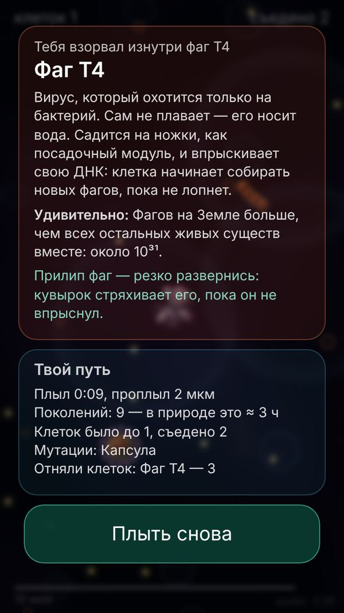

# Эволюция и вымершие

Роман, 24.11: «это все таки у нас рпг симуляция эволюции!… Чтобы выводить свои виды продумать скорость эволюции и все что с этим связанно! Симулятор эволюций!» Это направление всей игры. Раздел про выведение своих видов стоит первым; ниже то, что было продумано раньше и стало его частью.

Расширение книги, кусок 2 (24.11.2026). Роман, 24.11: «Чтобы мутации и ветки развития были с оригинальной эволюции! Вымершие бактерии!»

Две честные опоры (наше). Первая: эволюцию кишечной палочки люди видели своими глазами, в опыте Ленски она идёт с 1988 года. Из него берём всё, что происходит с твоей клеткой между заплывами. Вторая: вымерших бактерий как видов наука почти не знает, от них остались формы в камне и постройки. Их показываем как есть, с пометкой «кем он был, неизвестно», и ничего не выдумываем.

# РПГ-симулятор эволюции

Главная мысль (замысел отдельной работы, полный текст с источниками: design/zaplyv_evolyuciya.md): заплыв это одна жизнь, а между заплывами проходит «ночь рода», тысяча поколений за полминуты. Мутации случайны, ты их не выбираешь. Ты выбираешь, где жить и какой опасности подставить свой род, и этим сам становишься отбором. Ветка, которая достаточно изменилась, становится твоей породой с твоим именем. Биолог попросил говорить «порода»: до настоящего нового вида в природе больше двухсот тысяч отличий, и это число стоит в карточке Альманаха.

Роман, 24.11, 23:40: «можно попробовать реализовать как режимы игры внутри того что у нас есть! - механики существующие!… почему бы не реализовать все идеи потом выберем что оставить». Это его «да» на все пункты раздела. Биолог раздел проверил (круг 9, правки внесены). Строим режимами, каждый отдельной версией: Ночь рода, Селекция, Стая, Хищник, Засуха, Собиратель, Глубокое время, Море. План режимов: design/zaplyv_rezhimy.md.

## Режимы и меню-сценка

{{zapisi:simulyator:Режимы игры}}

## Ты и есть отбор

{{zapisi:simulyator:Ты и есть отбор}}

## Ночь рода

{{zapisi:simulyator:Ночь рода}}

## Своя порода

{{zapisi:simulyator:Своя порода}}

## Герои с сильной механикой

Роман, 24.11: «Лучше теме у кого механики интересные хищники гении эволюции!»

{{zapisi:simulyator:Герои с сильной механикой}}

## Глубокое время и «что если»

Роман, 24.11: «создать свою эволюцию добавить вымершие виды - возможную эволюцию продумать!»

{{zapisi:simulyator:Глубокое время и «что если»}}

# Что было продумано раньше

## Твоя эволюция

То, что остаётся с тобой после заплыва. Сейчас гибель стирает всё, кроме карточек.

{{zapisi:evolyuciya:Твоя эволюция}}

## Кабинет: твой штамм

Роман, 24.11: «Чтобы можно было в кабинете прокачивать своего персонажа как в рпг». Прокачка по науке это наследство: что закрепилось у потомков, то и твоё.

{{zapisi:evolyuciya:Кабинет: твой штамм}}

## Древний мир

Второй заплыв на тех же правилах: капля два миллиарда лет назад.

{{zapisi:evolyuciya:Древний мир}}

## В каком порядке строить (наше)

1. **В3 время в природе** и **В12 первый предок**: строка и карточка, почти бесплатно.
2. **В2 родословная**: экран гибели начинает рассказывать историю заплыва.
3. **В1 заморозка**: гибель перестаёт стирать всё. Это сильнее всего меняет желание сыграть ещё раз.
4. **В5 мутатор** и **В4 редкое открытие**: глубина выбора дочек.
5. **В6 «ты стал похож на…»**: когда генов в игре станет больше десяти.
6. **Древняя капля** одним большим куском после ила: В7, потом В8–В11, в конце В13.

## Источники

1. Lenski R. Experimental evolution and the dynamics of adaptation and genome evolution in microbial populations. *ISME Journal*, 2017.
2. Madigan M. и др. *Brock Biology of Microorganisms*, 16-е изд., 2021. Скорость деления в кишечнике: сверить у биолога.
3. Blount Z., Borland C., Lenski R. Historical contingency and the evolution of a key innovation in an experimental population of *Escherichia coli*. *PNAS*, 2008.
4. Sniegowski P., Gerrish P., Lenski R. Evolution of high mutation rates in experimental populations of *E. coli*. *Nature*, 1997.
5. Sonnenborn U. *Escherichia coli* strain Nissle 1917: from bench to bedside and back. *FEMS Microbiology Letters*, 2016.
6. Knoll A. *Life on a Young Planet*, 2003.
7. Wacey D. и др. Microfossils of sulphur-metabolizing cells in 3.4-billion-year-old rocks of Western Australia. *Nature Geoscience*, 2011; Allwood A. и др. Stromatolite reef from the Early Archaean era of Australia. *Nature*, 2006.
8. Lyons T., Reinhard C., Planavsky N. The rise of oxygen in Earth's early ocean and atmosphere. *Nature*, 2014.
9. Barghoorn E., Tyler S. Microorganisms from the Gunflint chert. *Science*, 1965.
10. Moody E. и др. The nature of the last universal common ancestor and its impact on the early Earth system. *Nature Ecology & Evolution*, 2024.
11. Imachi H. и др. Isolation of an archaeon at the prokaryote–eukaryote interface. *Nature*, 2020.
12. Kacar B. и др. Experimental evolution of *Escherichia coli* harboring an ancient translation protein. *Journal of Molecular Evolution*, 2017.
