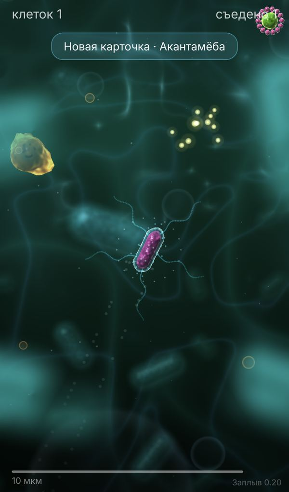

# Герой: за кого ты играешь

Роман, 24.11: «И вообще что за клетку мы играем? Нужно как то этот момент классно доработать!»

Ты кишечная палочка, *Escherichia coli*. Палочка длиной две тысячных миллиметра, с пучком жгутиков, из тёплого кишечника. В пруд ты попала случайно и хочешь домой. Твой характер (наше): **спринтер и проныра**. Ты не самая сильная и не самая защищённая, но ты быстрее всех растёшь на пиру, ешь почти всё и можешь жить там, где другим нечем дышать. Игрок должен это почувствовать руками в первую минуту, а не прочитать.

{{zapisi:geroy:Герой}}

## Держаться вместе

Роман, 24.11: «расплываются у нас в разные стороны бактерии… чтобы бактерии держались с друг другом вместе!… В общем проблему превратить в достоинство игры!»

В природе это настоящее умение кишечной палочки, и у него настоящая цена. Поэтому в игре это не починка, а выбор: плотом или врассыпную.

{{zapisi:geroy:Вместе}}

## Источники

1. Madigan M. и др. *Brock Biology of Microorganisms*, 16-е изд., 2021.
2. Blount Z. The unexhausted potential of *E. coli*. *eLife*, 2015.
3. van der Woude M., Henderson I. Regulation and function of Ag43 (Flu). *Annual Review of Microbiology*, 2008.
4. Matz C., Kjelleberg S. Off the hook: how bacteria survive protozoan grazing. *Trends in Microbiology*, 2005.
