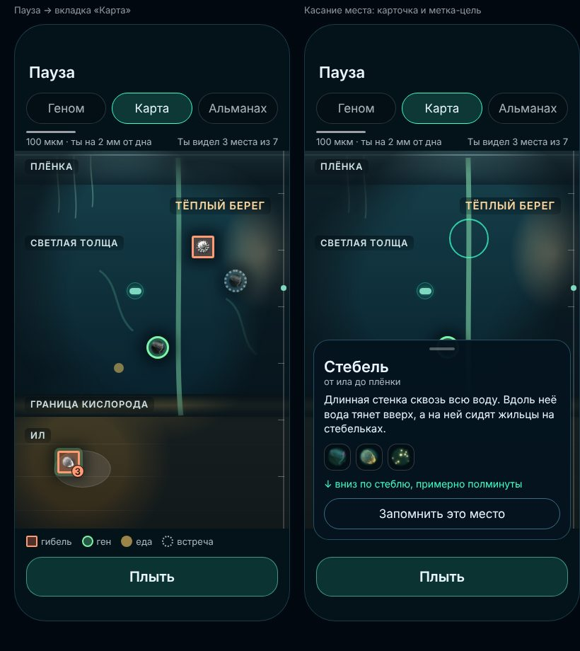

# Карта и встречи

Роман, 24.11: «Я так же бы хотел разработать карту! Чтобы она перед тобой динамически восоздавалачь но был план какой то! В дальнейшем я хочу добавить мультиплеер. Чтобы можно было встречаться с другими».

Решение (наше): планом мира служит настоящий пруд в разрезе. Места стоят на своих местах, а жизнь в них каждый заплыв собирается заново. Карта открывается по мере пути и ведёт к тёплому берегу, откуда начинается дорога домой.

## Карта

Макет карты и паузы с вкладками — на вкладке «Экраны» (**Э17–Э19**).

{{zapisi:karta:Карта}}

## Встречи с другими игроками

Строим ступенями от простого. Первые две ступени не требуют сервера и работают на нынешнем сайте.

{{zapisi:karta:Встречи}}

## В каком порядке строить (наше)

1. **К1 с тремя зонами** (плёнка, толща, ил) и карта на паузе. Самый маленький играбельный кусок: мир получает верх и низ, а игрок видит, где был.
2. **К6, только тест повторяемости**: один вход на одном зерне даёт один и тот же мир. Это страховка для всего остального.
3. **К2 и К3**: зоны данными и ориентиры.
4. **К4 тёплый берег**: у игры появляется цель.
5. **К5 гость по ссылке**: первая встреча с другом.
6. **К6 след друга**, потом решение о **К7**.

## Источники

1. Wetzel R. *Limnology: Lake and River Ecosystems*, 3-е изд., 2001.
2. Valles-Colomer M. и др. The person-to-person transmission landscape of the gut and oral microbiomes. *Nature*, 2023.
3. Lenski R. Experimental evolution and the dynamics of adaptation and genome evolution in microbial populations. *ISME Journal*, 2017.
4. Madigan M. и др. *Brock Biology of Microorganisms*, 16-е изд., 2021.
