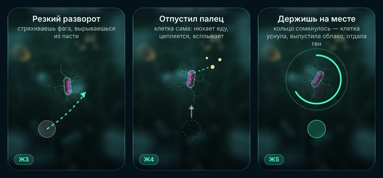

# Навыки: что само, что по жесту

Роман, 24.11: «некоторые навыки должны быть активными некоторые пассивными… На каждый эффект ищем реальный референс и по нему выстраиваем физику».

## Правило (наше)

**Пассивный навык работает сам.** Его видно по телу и по тому, как клетка себя ведёт. Кнопок у него нет.

**Активный навык включается жестом, похожим на само действие.** Жестов всего пять, новых кнопок на экране не появляется, и каждый жест работает только тогда, когда нужный ген есть.

| Жест | Что это | Пометки |
|---|---|---|
| **Ж1** Ведёшь палец | плывёшь, сила по сдвигу | ✅ 0.3 |
| **Ж2** Короткое касание | делишься | ✅ 0.16 · ⚠️ срабатывает случайно, чинили в 0.6 |
| **Ж3** Резкий разворот | кувырок: стряхиваешь фага, вырываешься из пасти | ✅ 0.4 |
| **Ж4** Отпустил палец | клетка делает то, что умеет без хода: подруливает к еде, цепляется у поверхности, всплывает, тянется вниз по компасу | 💡 |
| **Ж5** Держишь палец на месте дольше 1 с | «замри»: вокруг клетки сжимается кольцо, и она делает то, что требует покоя: засыпает, выпускает облако, отдаёт ген сородичу рядом | 💡 |

**Почему так, а не кнопки.** Кнопки заняли бы низ экрана, а Роман играет одним большим пальцем. Жест Н4 — это просто «убрал палец», жест Н5 — «не двигаюсь»: случайно их не сделать, потому что во время игры палец всё время ведёт. У Н5 есть кольцо-предупреждение, его можно сорвать движением до того, как оно сомкнётся.

**Чего не делаем.** Двойного касания нет: оно путается с делением (Ж2). Долгого нажатия пальцем на существо нет: палец закрывает то, во что целишься.

## Пассивные навыки

| Ген | Как видно, что он работает | Настоящий эффект, с которого списано | Пометки |
|---|---|---|---|
| **Г1** Жгутик | в слизи клетка не вязнет, нити бьют быстрее | жгутики крутятся мотором; роение по поверхности идёт пластом | ✅ 0.23 · 🔬 ← Н18 |
| **Г2** Хемотаксис | огоньки на носу мигают, когда рядом еда | клетка не правит к цели, а реже кувыркается, пока вкуснее: выходит дрейф в нужную сторону | ✅ 0.23 · 🔬 ← Н18 |
| **Г6** Быстрый рост | розовых рибосом вдвое больше, деление раньше | после богатой еды разгон не сразу: сначала строятся рибосомы | ✅ 0.23 · 🔬 ← Н21 |
| **Г11** Капсула | прозрачный ореол, из пасти выскальзываешь | скользкий слой мешает ухватить | ✅ 0.9 · 🔬 |
| **Г13** Сменил замок | синие бугорки, фаг T4 отскакивает, еда входит медленнее | фагу не за что зацепиться, но та же дверца — вход для еды | ✅ 0.23 · ❔ |
| **Г14** CRISPR | полоска за каждый пережитый вид фага, она вспыхивает рядом с ним | память о фаге, чью ДНК клетка пережила | ✅ 0.9 · 🔬 |
| **Г8** Световой насос | в лучах худеешь медленнее, тело розово-пурпурное | свет даёт силы, но не еду | 💡 ❔ |
| **Г9** Малый кислород | в полосе над илом растёшь, где другим душно | дыхание при следах кислорода | 💡 🔬 ← Н22 |
| **Г10** Запас | сытая копит зёрна, в голод они тают | внутренний склад на чёрный день | 💡 🔬 ← Н24 |
| **Г19** Устойчивость | у плесени не гибнешь, и рядом с тобой выживают сородичи | фермент разбирает яд и вокруг клетки, поэтому у устойчивой колонии появляются соседи-«спутники» | 💡 🔬 ← Н15, Н52 |
| **Г21** Профаг | такие фаги больше не садятся; у поверхности может проснуться | вирус спит в кольце, свет будит его | 💡 🔬 ← Н33 |
| **Г5** Компас | без пальца клетка сама поворачивается носом вниз, к илу | поле не тянет, а только задаёт направление: плывёт клетка сама | 💡 🔬 |
| **Г22** Цепочка | дочки не расходятся, длинную цепочку пасти глотают хуже | клетки не дорезают перегородку | 💡 🔬 ← Н27 |
| **Г17** Кворум | когда своих рядом четверо, слизь гуще | клетки слышат, сколько их | 💡 🔬 |
| **Г23** Удар касанием | врезался в сородича — он замирает и перестаёт расти | работает только при настоящем касании; свои целы | 💡 🔬 |

## Активные навыки

| Ген | Жест | Что происходит | Цена | Пометки |
|---|---|---|---|---|
| **Г3** Фимбрии | **Ж4** отпустил палец у водоросли или дна | волоски цепляются, поток не уносит; чем сильнее тянет, тем крепче держат. Повёл палец — отцепился | стоишь на месте, еда проплывает мимо | 💡 🔬 ← Н19 |
| **Г4** Газовые пузырьки | **Ж4** отпустил палец | медленно всплываешь к свету, пока не поведёшь снова | наверху светло и опасно | 💡 ❔ |
| **Г15** Сон | **Ж5** замер | тело тускнеет, одна клетка спит: переживает плесень, фага и голод (фагу в спящей нечем размножаться). Разбудит движение | спящая не ест и не плывёт, пасть и амёба проглотят и её | 💡 🔬 ← Н26 |
| **Г18** Колицин | **Ж5** замер рядом с чужими палочками | твоя клетка лопается и выпускает облако: гибнут палочки без этой плазмиды, остаётся еда. Твои с той же плазмидой целы | теряешь ту клетку, которой выпустил: это последний удар, а не кнопка | 💡 🔬 ← Н36–Н38 |
| **Г20** Плазмида F | **Ж5** замер вплотную к сородичу | тянешь к нему трубочку и отдаёшь ген: он становится твоим, держится рядом | на трубочку садятся свои фаги | 💡 🔬 ← Н14 |
| — | **Ж3** кувырок | стряхиваешь фага, вырываешься из пасти | рывок стоит сил | ✅ 0.16 · 🔬 |

## Как считаем эффект

Правило (наше): у каждого навыка берём **настоящий референс** и из него три числа: **как быстро**, **как сильно**, **как далеко**. Их кладём в data.json, а не в код.

| Навык | Из референса (числа от биолога) | В игре (число в data.json) | Пометки |
|---|---|---|---|
| **Г1** Жгутик | бег 0,86 с, кувырок 0,1 с, новый курс в среднем 68°, мотор около 100 оборотов в секунду; сама клетка сбивается с курса примерно на 90° за 10 с | бег и кувырок уже есть (кувырок 0,22 с); довести кувырок до 0,1 с и разброс курса до 68° | ✅ 0.4 · 🔬 ← Н18 |
| **Г3** Фимбрии | связь-«наручники»: слабый поток отрывает, сильный только затягивает; в стоячей воде клетка отцепляется сама | держишь тем крепче, чем сильнее тянет поток коловратки; в тихой воде отпускает сама | 💡 🔬 ← Н19 |
| **Г15** Сон | в сытой колонии спит одна клетка на сотни тысяч, в голодной до сотой части; просыпаются вразнобой | спит одна твоя клетка, не весь клон; в голод их больше; пробуждение по движению | 💡 🔬 ← Н26 |
| **Г18** Колицин | выходит только когда клетка-носитель разрушается, и запускает это беда: яд плесени или свет | «замри» рядом с чужими — твоя клетка лопается облаком; свои целы | 💡 🔬 ← Н36–Н38 |
| **Г23** Удар касанием | только при касании, и часто не убивает, а останавливает рост на минуты | сородич замирает и перестаёт расти, не гибнет | 💡 🔬 |
| **Г19** Устойчивость | без яда плесени стоит несколько процентов скорости роста, плазмида теряется | медленнее делишься, без плесени колечко бледнеет и выпадает | 💡 🔬 ← Н15, Н52 |
| **Г16** Плёнка | в плёнке клетки терпят яд в сотни раз дольше, чем поодиночке | в плёнке облако плесени почти не берёт | 💡 🔬 ← Н25 |
| **Г4** Пузырьки | всплытие медленное, порядка единиц мкм в секунду | всплываешь заметно медленнее, чем плывёшь | 💡 ❔ число подтвердит биолог |
| **Г5** Компас | бактерии-компасы идут 40–100 мкм/с, быстрее палочки; поле только задаёт курс | поворот носом вниз, скорость своя | 💡 🔬 |

**Масштаб игры (наше).** В «Заплыве» 26 точек мира — это 1 мкм, клетка идёт около 7 мкм в секунду. Настоящая палочка идёт 15–30 мкм/с, то есть вдвое-вчетверо быстрее, но на экране телефона это рябит. Упрощение записано здесь честно (← Н18).

## Что отдаём строителю первым

1. Жест **Ж5** «замри» с кольцом и сон **Г15** вместо споры: один жест, один навык, видно сразу. Спору оставляем карточкой бациллы.
2. Жест **Ж4** «отпустил палец» на том, что уже есть: хемотаксис подруливает.
3. Дальше фимбрии **Г3**, облако **Г18**, пузырьки **Г4**.
