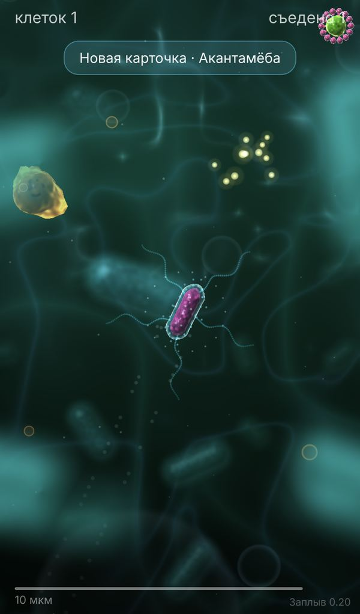

# Книга «Заплыва»

**Версия книги 2 · 24.11.2026.** Вся игра в одном месте: что уже есть, что строим, что задумано и что сверено с биологами. По этой книге выравниваем игру.

## Как читать пометки

- ✅ **в игре** с версии · 🔧 **строим** · 💡 **задумано**
- 🔬 **сверено биологом** · ⚠️ **биолог нашёл ошибку** · ❔ **ещё не сверено**
- 🧪 **чем проверяем**: тест или кадр

## Как поправить

У каждого пункта номер: **Д3**, **Г7**, **С2**. Коснись номера, он скопируется. Скажи или вставь в чат: «Г7 не так, хочу…». Мы поправим пункт и игру.

Буква — раздел: **Д** как плывёшь, **М** мир, **С** существа, **Г** гены, **П** пути генов, **Э** экраны, **Ц** план.

Слова Романа даны дословно с датой. Наши решения помечены «наше».
