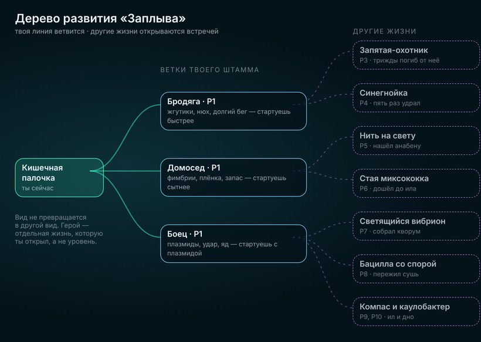

# В разработке

Роман, 24.11: «Это пускай разделом в разработке останется это нужно утверждать новые механики — просто отдельно в книге это готовьте».

Здесь всё новое, чего в игре ещё нет и что меняет саму игру: новые существа, новые места, эволюция, карта, дорога домой. Мы готовим каждый пункт до конца: наука, как это выглядит в игре, как строить. Но в стройку он идёт только после твоего «да».

**Как утвердить.** Проще всего на вкладке «Решения»: там те же пункты собраны в несколько решений с кнопками. Или назови номер: «С25 да», «Т1–Т7 да», «ил не надо». Можно целой вкладкой: «дорогу домой утверждаю». Утверждённый пункт получает пометку с датой и встаёт в очередь стройки. Это следит машина: новая механика без твоего «да» не может уйти строителю.

**Что идёт без утверждения.** Доводка того, что уже есть и что ты уже назвал: еда, кабинет, значки, флажок, жгутики, навыки, тексты, меню по макету после твоего слова.

{{razrabotka}}

## За кого ещё можно поиграть (герои Р1–Р12)

Роман, 24.11: «Мы играем сейчас за кишечную палочку! То есть мы эволюционировать дальше не сможем? Это самый классный выбор? Надо продумать, за кого ещё можно будет поиграть».

**Короткий ответ (наше).** Палочка — отличный выбор, и упереться в потолок она не даёт. Эволюция у неё настоящая и видна своими глазами: в опыте Ленски её линии меняются с 1988 года, и одна научилась есть то, чего палочка не ест. Это уже расписано на вкладке «Эволюция» (В1–В17): заморозка, родословная, мутатор, редкое открытие. Чего не хватало — двух вещей: чтобы твоя линия становилась **своей** (ветки штамма), и чтобы рядом была **другая жизнь**, за которую можно сыграть.

**Чего мы не делаем.** Палочка не превращается за заплыв в амёбу или в нить: виды так не работают. Герой — это не следующий уровень, а отдельная жизнь, которую ты открыл, узнав существо в деле.

**Круг биолога пройден (24.11).** Биолог проверил все двенадцать записей: «наука верна везде, ни одной выдумки». Точные числа встали в науку (160 микрон в секунду у охотника, 68 ньютонов на квадратный миллиметр у клея каулобактера, каждая десятая-двадцатая клетка нити). Одна поправка ждёт слова Романа: светящиеся бактерии морские, поэтому вибриону (**Р7**) нужна своя солёная вода — либо новая локация, либо другое умение в пруду.

{{zapisi:geroi}}

**Слова Романа 24.11 по этим записям:** «не понятна механика звучит классно — но что-то бродяга — как будто из другой оперы, а запятая-охотник вроде норм. Вымершие вроде гуд звучит». Наше: ветки штамма (**Р1**) переписываем, прежде чем звать их в стройку — названия «бродяга, домосед, боец» уводят в сторону от бактерии; герой-охотник (**Р3**) и вымершие идут вперёд.

**Роман 24.11 про героев:** «Лучше теме у кого механики интересные хищники гении эволюции! Либо вообще создать свою эволюцию добавить вымершие виды — возможную эволюцию продумать! Чтобы выводить свои виды продумать скорость эволюции и всё что с этим связанно! Симулятор эволюций! Было бы круто это задача для файла потому что это почти научная работа». Наше: из героев вперёд идут те, у кого своя механика (охотник **Р3**, стая **Р6**, хищная синегнойка **Р4**); светящийся **Р7** остаётся в книге с морской водой, но без очереди. Симулятор эволюции ведёт отдельный тред.

## В каком порядке, если Роман скажет «берём» (наше)

1. **Р2 соседи-штаммы** — дешевле всего и сразу оживляет каплю.
2. **Р1 три ветки** — сперва переписать на языке клетки, а не прозвищ (Роман: «как будто из другой оперы»); механика остаётся: твоя линия становится своей и ложится на готовую родословную В2.
3. **Р3 бделловибрион** — первый герой: мир тот же, игра другая. По нему видно, стоит ли делать остальных.
4. Дальше по одному, сперва с механикой: синегнойка, стая миксококка, бацилла со спорой, компас, каулобактер, нить. Светящийся вибрион — последним и только с морской водой.
