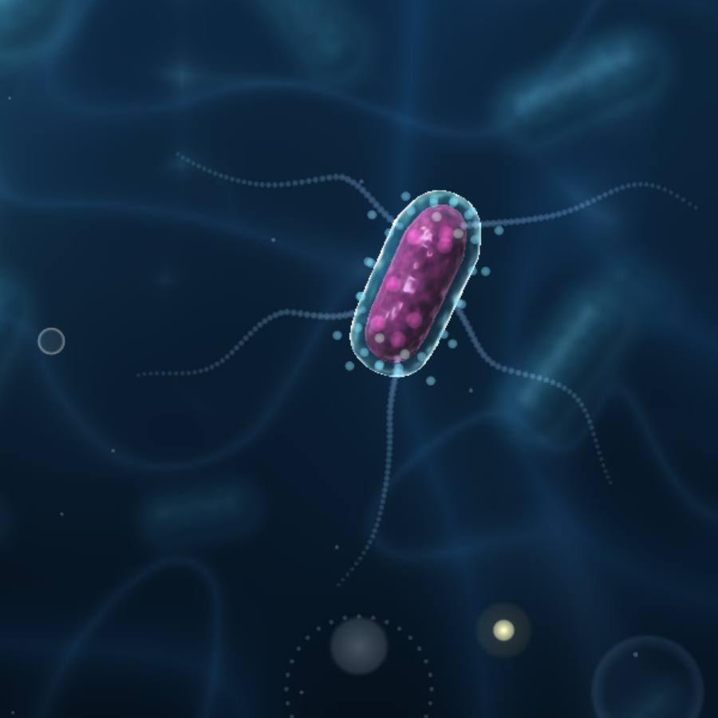

# Навыки: таблица

Роман, 25.11: «по навыкам они не прибавляют игрового прикола. Их нужно сделать более явными, более четкими… такое ощущение, что референсы никто не ищет на навыки, они по описанию составляют, в итоге они не очень-то красочные получаются. У нас все-таки игра, несмотря на то, что она образовательная».

Здесь каждый навык одной карточкой: номер, название, что делает, кадр из живой игры, настоящий референс из природы и что сделать, чтобы стало ярче. Номер можно назвать голосом: «Г13 не видно».

## Что видно сразу

- **Ты прав.** Из семнадцати навыков в игре только семь заметны. Шесть заметны слабо, четыре не видны совсем. У пяти кадр клетки с навыком не отличить от кадра без навыков.
- **Хуже всего навыки-щиты.** «Вирус не прилипает», «Шарики не вредят», «Вирус остаётся внутри» работают отказом: беда не случилась, и на экране не случилось ничего. Им нужен момент срабатывания: вспышка, соскальзывание, отскок.
- **Референсы до сих пор не искали.** Все семнадцать рисовали по описанию биолога. Теперь для одиннадцати найден настоящий снимок или рисунок учёных, ссылка в карточке. Для шести не нашли, там так и написано.
- **Честно про референсы.** Сайты со снимками закрыты для наших машин: мы нашли страницы поиском и прочитали подписи к снимкам, но сами картинки не видели. Ссылки с телефона открываются. Посмотри глазами и скажи, где наш рисунок далёк.
- **Образцы уже есть.** «Ядовитое касание» (розовые иглы), «Сёстры рядом» (комок с застёжками), «Ест голубую еду» (еды на экране становится больше): так должен читаться каждый навык.

## Как читать карточку

- **На кадре.** Что видно на клетке в живой игре, на экране телефона. Кадр снят с версии 0.63: клетка с одним этим навыком, без пальца.
- **В природе** и **Референс.** Как это выглядит на самом деле и где посмотреть настоящий снимок. Если снимок не нашёлся, так и написано.
- **Близко ли.** Насколько наш рисунок похож на настоящий.
- **Что сделать.** Как сделать навык ярче. Это предложения, в стройку они идут после твоего слова.

## Клетка без навыков, для сравнения

## Навыки, которые уже в игре

{{umeniya}}

## Навыки, которых в игре ещё нет

Они описаны в книге и ждут стройки. Кадра нет, референс для каждого подберём до того, как строитель начнёт рисовать, а не после. Ещё около пятидесяти мутаций лежат в каталоге биолога без карточек, и девять навыков по кнопке ждут твоего слова на вкладке [Решения](#resheniya).

{{umeniya_net}}

## Чего в таблице пока нет

- Кадров самого момента срабатывания: амёба схватила и ты выскользнул, вирус сел на пузырёк, сестра тихо погасла. Здесь кадры клетки в покое. Моменты доснимем следующей версией.
- Референсов для навыков, которых ещё нет в игре.
