# Вид существ: как в жизни и как у нас

Роман, 25.11: «Как сделать чтобы референсы искали? На все?»; «Документ обновляйте у нас образовательная игра! Нам нужно чтобы это выглядело примерно как в жизни».

Здесь каждый, кто уже есть в игре: существа, вирус и еда. У каждого одна карточка: как он выглядит под микроскопом, как нарисован у нас, насколько мы расходимся и что поправить. Сверху те, кто дальше всего от настоящего. Список составил биолог 25.11 по сборке 0.68.

## Что важно знать заранее

- **Внешность до сих пор не проверяли.** Все прежние проверки биолога были про поведение, размеры и тексты. Форму и цвет тел сверили впервые в этом списке.
- **Под микроскопом почти все бесцветные.** Настоящий цвет есть только у зелёной нити и у бурого комка. Остальные цвета в игре наши: это метки, чтобы ты за полсекунды отличал врага от еды. Мы их оставляем, но честно скажем об этом в Альманахе.
- **Картинки теперь есть.** До 25.11 биолог отвечал за приметы словами, а снимков никто не видел. Теперь тред референсов собрал и открыл глазами по образцу на каждое существо: они в разделе «Настоящие снимки» ниже. Старые ссылки в карточках остаются справкой.
- **Место под образец.** В каждой карточке есть строка «Образец». Пришлёшь снимок или рисунок, положим его туда рядом с нашим кадром. Чужие картинки из фотобанков с водяным знаком в книгу класть нельзя, для них даём ссылку.
- **Замечание.** У каждой карточки кнопка ✎: нажми и напиши, что не так. Номер можно назвать и голосом: «Ж1 колючки длиннее».

## Настоящие снимки: образец для каждого

Тред референсов 25.11 собрал картинки и каждую открыл глазами. Ниже лучшая на каждое существо. С этого дня кадр из игры сверяем с этими картинками и с твоими. Серый снимок годится только для формы. Остальные картинки, ролики и права лежат в рабочей папке `design/referensy`.

### Наша палочка

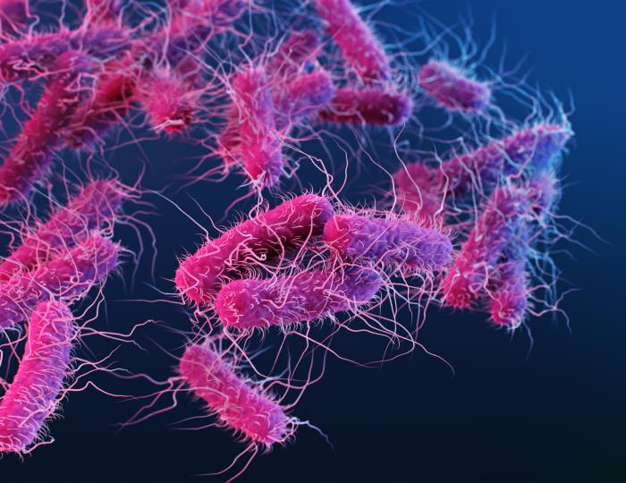

**Что берём.** Розово-сиреневое бархатное тело с мягким бликом, тёмно-синяя вода с глубиной, хвосты тонкими светлыми лентами в три-четыре раза длиннее тела.

**Что упрощаем.** Хвостов у нас четыре-шесть, а не сотня. Хвост крутится винтом, а не машет.

Автор и права: [Alissa Eckert, CDC, общественное достояние](https://phil.cdc.gov/Details.aspx?pid=23242).

### Сенная палочка

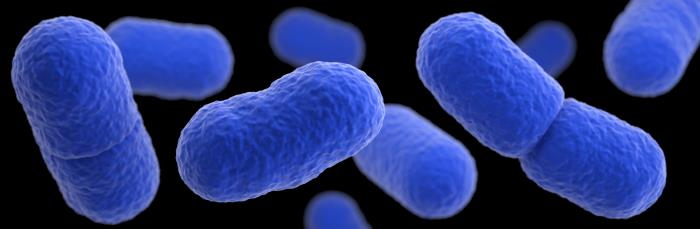

**Что берём.** Толстое тело-бочонок с тупыми концами и перетяжка между сёстрами: она ходит цепочкой.

**Что упрощаем.** Цепочка из двух-четырёх, хвосты редкие и тонкие, чтобы не путать с нашей.

Автор и права: [Jennifer Oosthuizen, CDC, общественное достояние](https://phil.cdc.gov/Details.aspx?pid=21917).

### Шарики гроздью

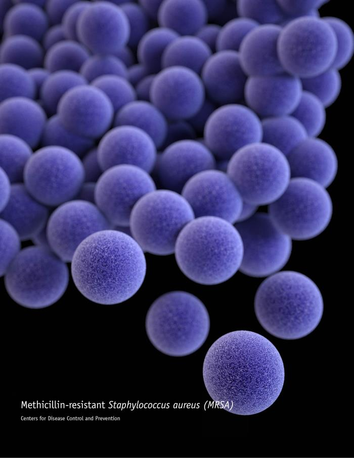

**Что берём.** Бархатные шары одного размера, плотно прижатые друг к другу, на каждом блик.

**Что упрощаем.** Гроздь из пяти-двенадцати шаров, с края они отделяются по одному. Гроздь не плывёт, её несёт вода.

Автор и права: [Jennifer Oosthuizen, CDC, общественное достояние](https://phil.cdc.gov/Details.aspx?pid=19059).

### Красная запятая

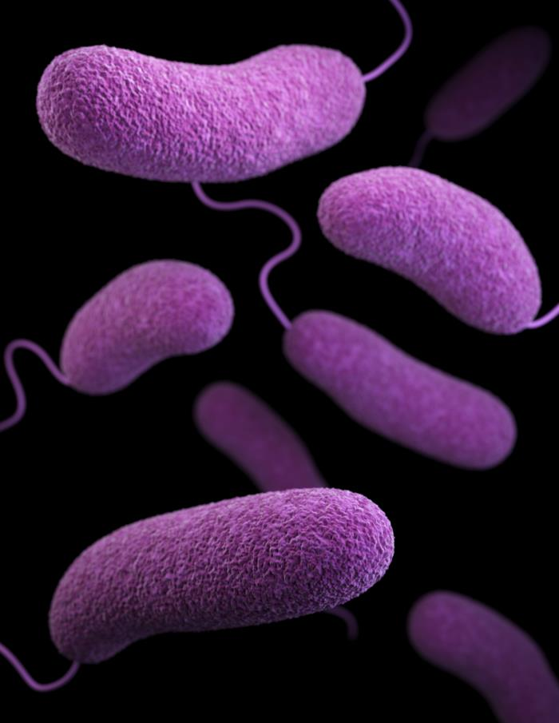

**Что берём.** Короткое изогнутое тело и один хвост с конца.

**Что упрощаем.** Тело втрое меньше нашего, цвет красный наш. Главный жест: рывок вперёд и щелчок хвостом.

Автор и права: [Jennifer Oosthuizen, CDC, общественное достояние](https://phil.cdc.gov/Details.aspx?pid=21921).

### Гарпунщица

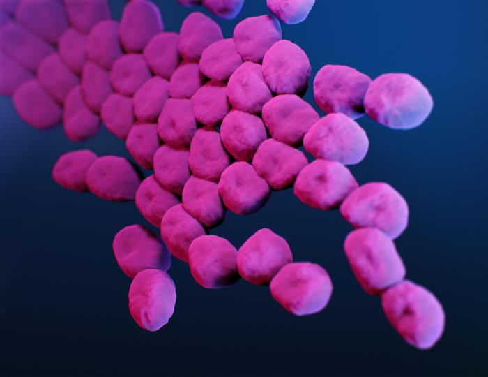

**Что берём.** Короткая толстая гладкая палочка, почти шарик. Это настоящий хозяин иглы.

**Что упрощаем.** Игла в природе не видна. У нас короткие шипы появляются только в миг удара.

Автор и права: [Dan Higgins и James Archer, CDC, общественное достояние](https://phil.cdc.gov/Details.aspx?pid=23235).

### Синегнойка

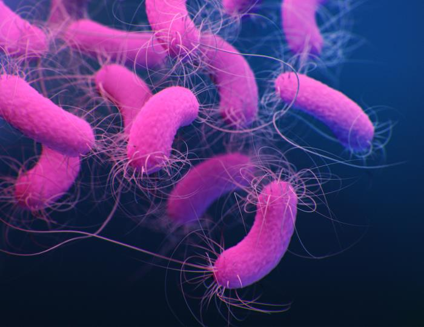

**Что берём.** Палочка с одним хвостом на конце и пушком ворсинок.

**Что упрощаем.** Цвет сине-зелёный, как её настоящая краска, чтобы ты отличал её от своей клетки.

Автор и права: [Jennifer Oosthuizen, CDC, общественное достояние](https://phil.cdc.gov/Details.aspx?pid=23249).

### Амёба ест

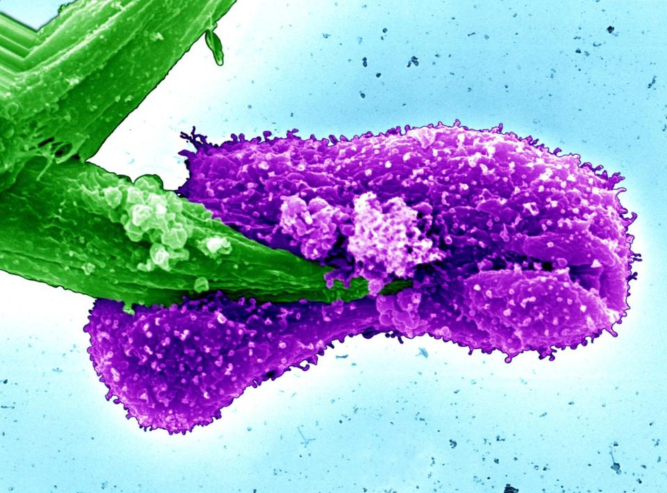

**Что берём.** Зернистое тело с колючими отростками по краю. Она обволакивает добычу рукавом, который наползает на кусок. Цвета на снимке дорисованы.

**Что упрощаем.** Пять-восемь колючек, тело как прозрачный студень с пузырьками внутри. Никакой клешни.

Автор и права: [Wellcome Collection, CC BY 4.0](https://wellcomecollection.org/works/z92m5nem).

### Туфелька

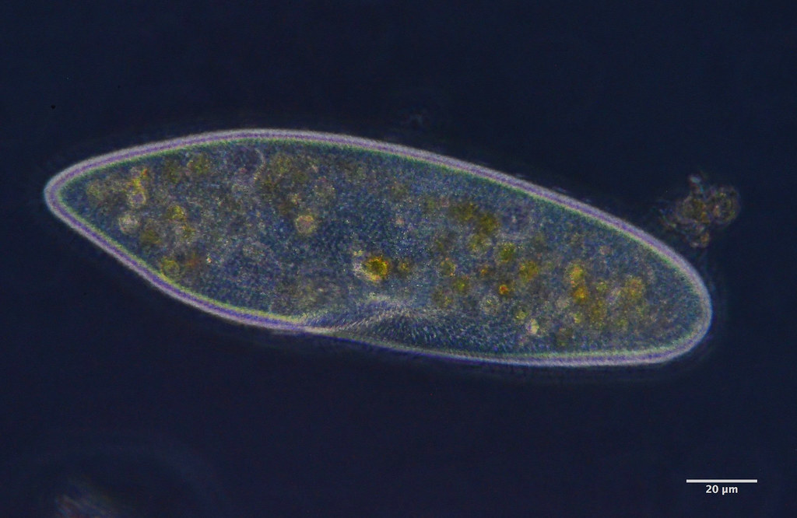

**Что берём.** Светящийся контур, золотые зёрна внутри, сбоку бороздка-рот, по краю ровный пушок ресничек.

**Что упрощаем.** Реснички идут бегущей волной по контуру, а не отдельными волосками.

Автор и права: [Don Loarie, CC BY 2.0](https://www.flickr.com/photos/loarie/21215821111/).

### Колокольчик

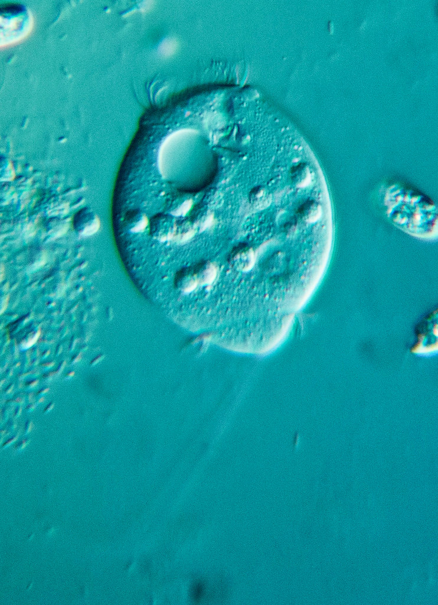

**Что берём.** Чаша с венцом ресничек на длинном тонком стебле, бирюзовый объём.

**Что упрощаем.** Стебель это одна гладкая пружина: резко сжимается спиралью и медленно распрямляется. Венец крутит вихрь и затягивает мелочь.

Автор и права: [Picturepest, CC BY 2.0](https://www.flickr.com/photos/picksfromoutthere/10714440134/).

### Коловратка

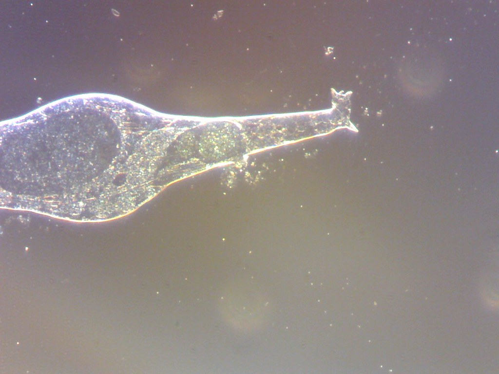

**Что берём.** Стеклянное тело, вытянутое как подзорная труба, внутренности видно насквозь.

**Что упрощаем.** На голове два вращающихся светлых венчика. Она огромная, на экране видна частью.

Автор и права: [smaller.pathological.ca, CC BY 2.0](https://www.flickr.com/photos/smaller-pathological/7185556283/).

### Вирус

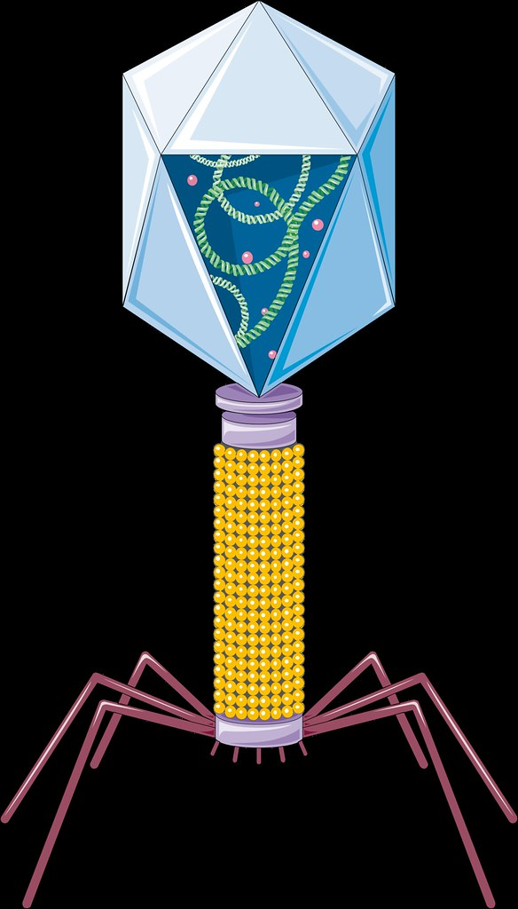

**Что берём.** Стеклянная голова-многогранник с нитью внутри, хвост-трубка и шесть тонких лап. Это рисунок, не снимок.

**Что упрощаем.** Голова как стеклянный кристалл с бликом. При посадке лапы упираются, хвост втыкается.

Автор и права: [Servier Medical Art, CC BY 2.0](https://www.flickr.com/photos/serviermedicalart/10085619254/).

### Вирус садится

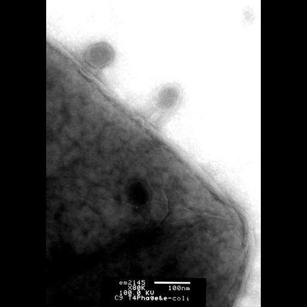

**Что берём.** Серый снимок, только для формы: вирусы сидят на краю палочки головой наружу, хвост упёрт в оболочку.

**Что упрощаем.** Лапы раскрываются, хвост сжимается и колет, голова пустеет и тускнеет.

Автор и права: [Louisa Howard, Cell Image Library, общественное достояние](https://www.cellimagelibrary.org/images/41123).

### Клетка в разрезе

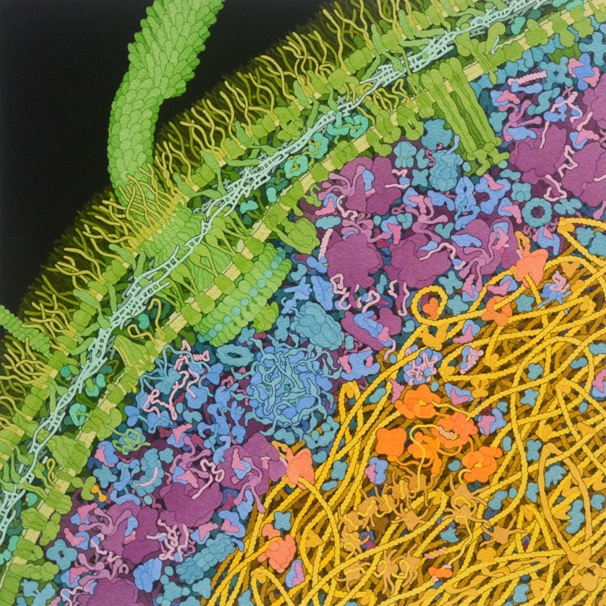

**Что берём.** Цвет по слоям: зелёная оболочка, фиолетовые станки, жёлтый клубок с записью клетки. Это рисунок учёного, каждая молекула на своём месте.

**Что упрощаем.** Три-четыре слоя цвета вместо сотен молекул. Разрез показываем в Альманахе и при приближении.

Автор и права: [David S. Goodsell, RCSB PDB-101, CC BY 4.0](https://cdn.rcsb.org/pdb101/goodsell/2022_Ecoli.pdf).

### Деление

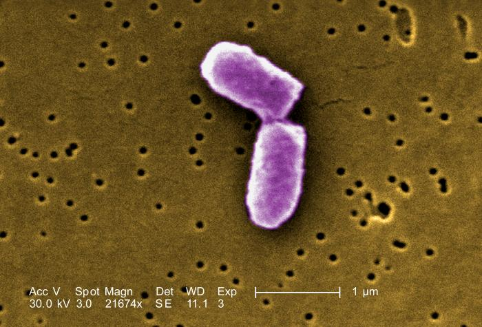

**Что берём.** Последний миг деления: две сестры, перетяжка почти сомкнулась, концы уже круглые. Цвета на снимке дорисованы.

**Что упрощаем.** Клетка плавно удлиняется всё время, перетяжка появляется в самом конце, сёстры мягко расходятся без вспышки.

Автор и права: [Janice Haney Carr, CDC, общественное достояние](https://phil.cdc.gov/Details.aspx?pid=10042).

**Чего пока нет.** Роликов, как плывёт и кувыркается палочка, с правом вставить в книгу не нашлось, есть только ссылки. Объёмных рисунков туфельки, колокольчика, коловратки и амёбы со свободными правами нет нигде, поэтому для них взяты живые цветные снимки.

## Строка для Альманаха

Предлагаем одну строку на всю игру: «Под микроскопом почти все здесь бесцветные и прозрачные. Цвета в игре это наши метки, чтобы ты различал, кто есть кто. По-настоящему цветные только зелёная нить и бурый комок.» И вторую, про еду: «Еду в воде никто не видит, даже под лучшим микроскопом. Мы показываем её точками, чтобы ты видел то, что клетка чувствует.» Биолог обе строки подтвердил 25.11, в игру их ставит строитель.

## Чем ещё слаба

Внешность сверена словами, а не по снимкам: сайты с фотографиями закрыты для наших машин, ссылки не проверены. Образцов-картинок в карточках пока нет, кроме кадра амёбы.

## Что делать сначала

1. Колючки амёбе (**Ж1**). Проба уже есть, кадр в карточке.
2. Венец и челюсти коловратке (**Ж2**).
3. Колокольчик сжимается в спираль, когда его напугали (**Ж3**).
4. Вирус садится на шесть лап, стоя как вышка (**Ж4**).
5. Строка про цвет в Альманахе.
6. Волна ресничек у туфельки, разваливающийся комок, спиральная лента у нити: когда дойдут руки.

## Все по порядку

{{vid}}
